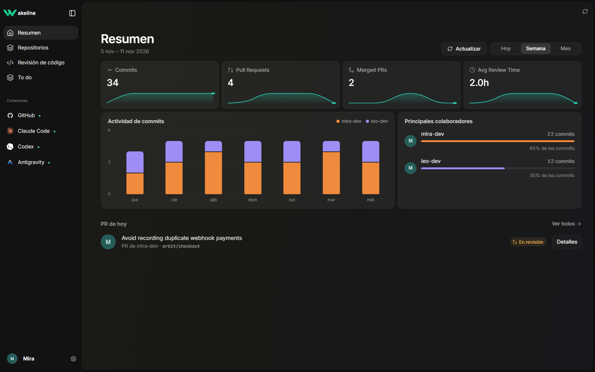
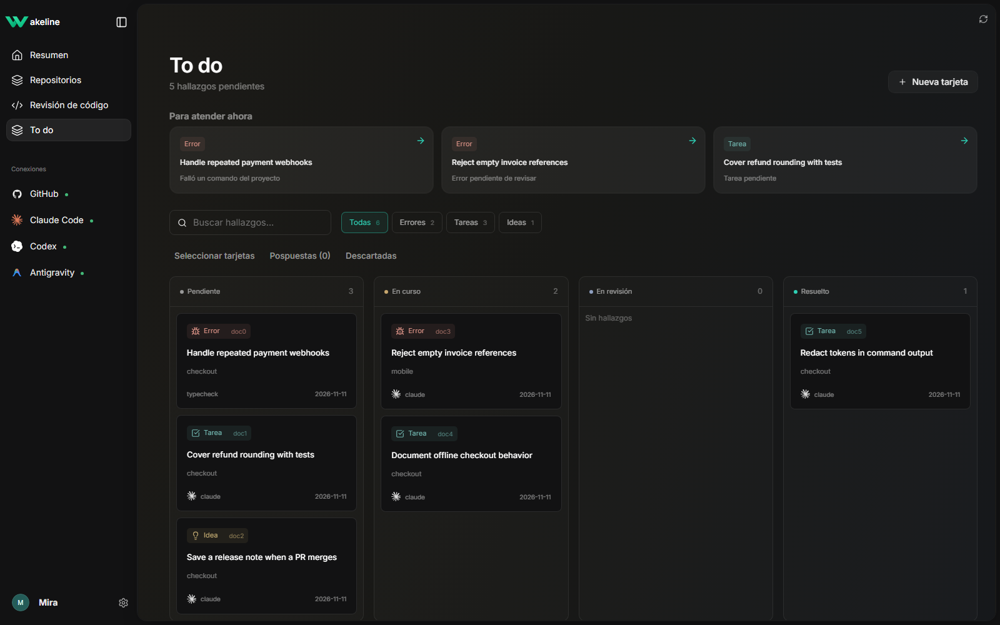
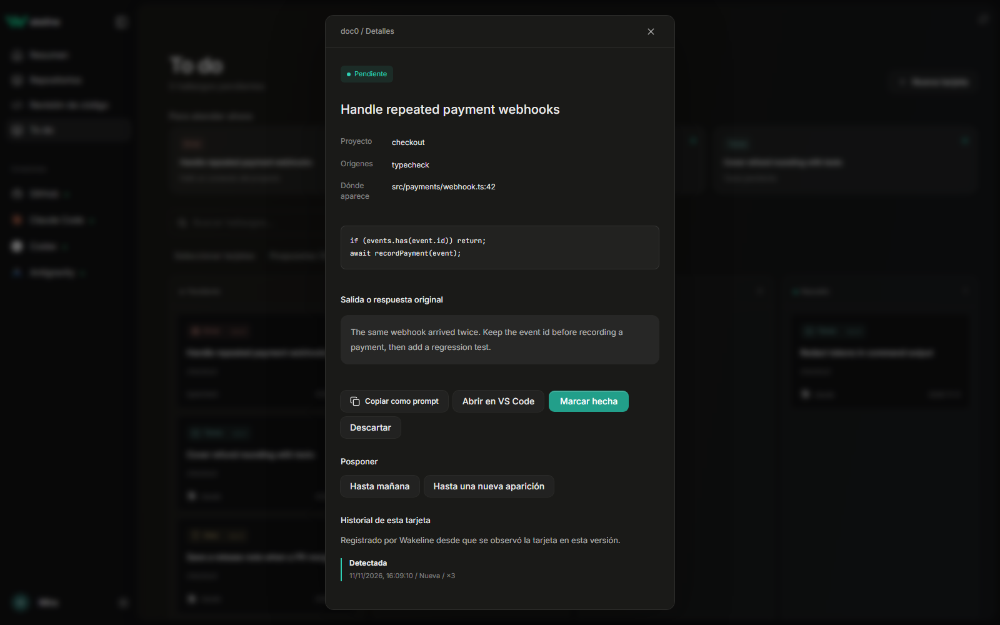
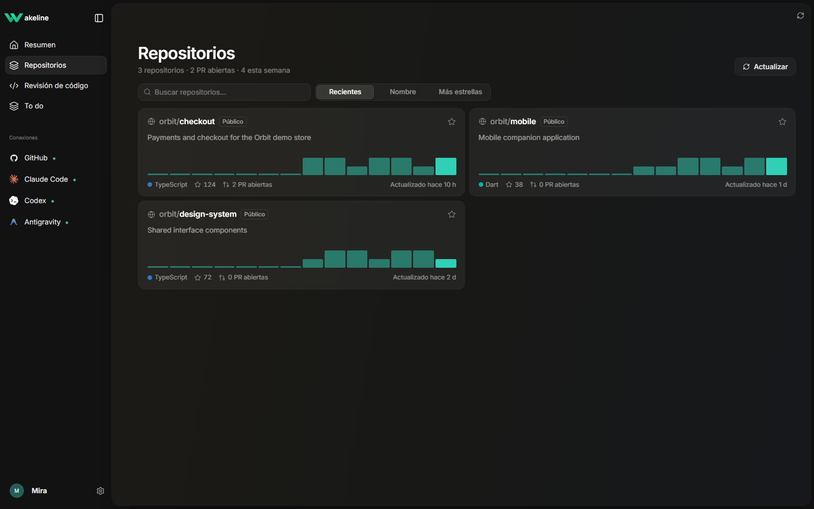
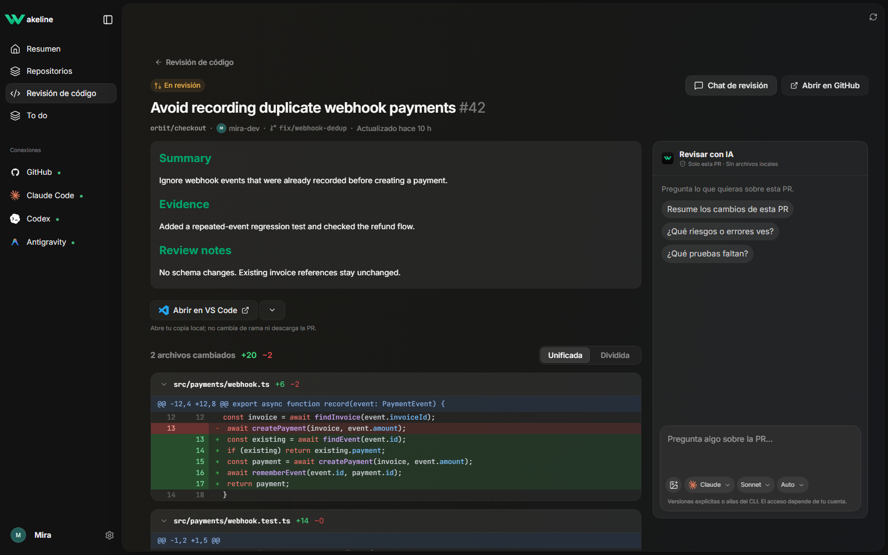
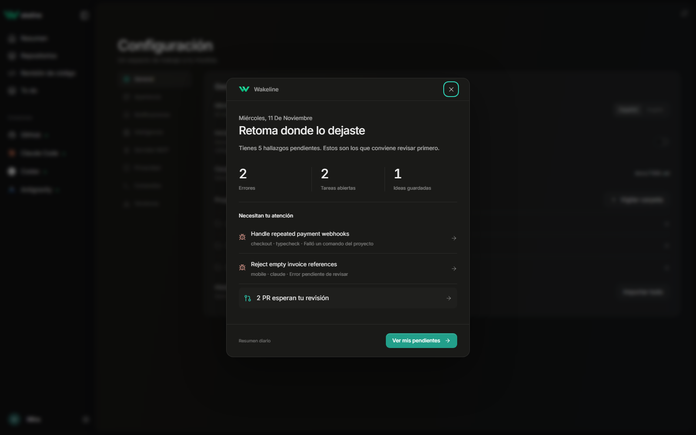
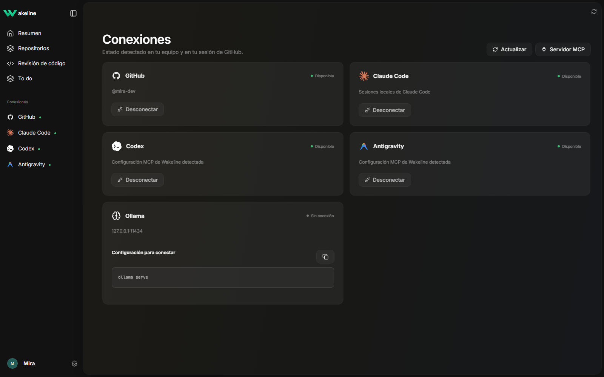
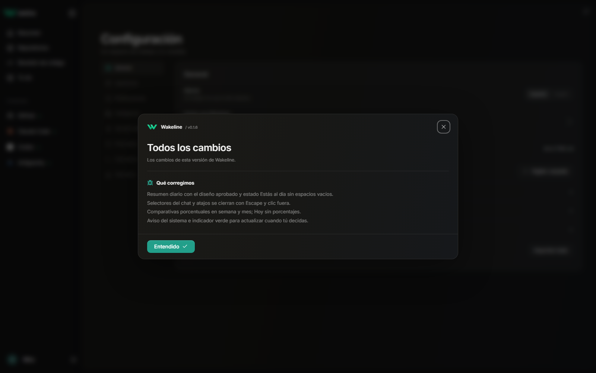
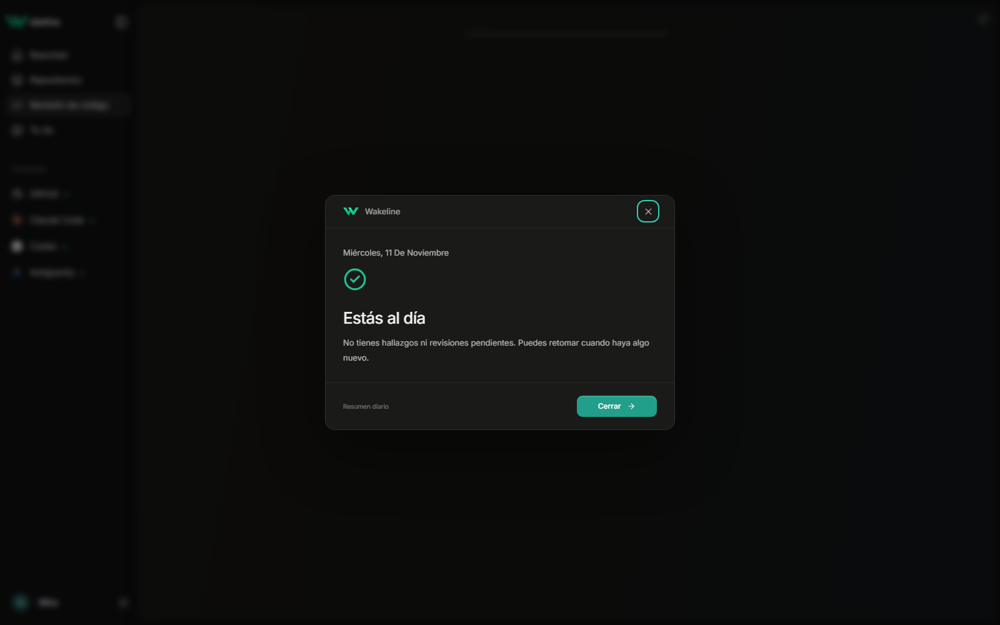
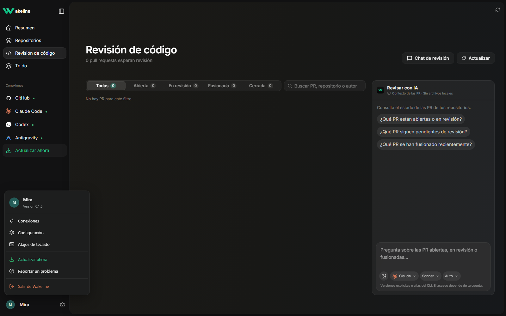

<p align="center"></p>
<h1 align="center">Wakeline</h1>
<p align="center">Los errores, tareas e ideas de tus sesiones de IA, sin perderse en el historial.</p>
<p align="center"><a href="README.md">English</a> · Español</p>

Wakeline es una aplicación de escritorio para Windows y Linux. Reúne hallazgos de los proyectos que eliges, sesiones de Claude Code, comentarios del código, resultados de comandos, documentos y GitHub. Tus proyectos y decisiones se guardan localmente.

[Descargar la última versión](https://github.com/hopsiedev/wakeline/releases/latest) · [Instalación y actualizaciones](RELEASE.md) · [Novedades de 0.1.6](RELEASE-NOTES.md)



_Todas las capturas usan proyectos, cuentas, código y actividad ficticios. Se generan desde la interfaz real; la aplicación publicada no carga estos ejemplos._

## Instalar y empezar

1. **Windows:** instala `Wakeline_*_x64-setup.exe`, o extrae el ZIP portable y abre `wakeline-app.exe`. Necesitas WebView2. Conserva `wakeline.exe` junto a la aplicación portable para usar MCP.
2. **Linux:** usa AppImage o DEB. AppImage puede necesitar FUSE 2; donde no esté disponible puedes usar `--appimage-extract-and-run`. Consulta la [guía de instalación](RELEASE.md).
3. Abre **Configuración → General** desde el engranaje junto a tu perfil y añade las carpetas que quieres vigilar. Sin carpetas elegidas no se analizan proyectos locales.
4. Instala [GitHub CLI](https://cli.github.com/) y ejecuta `gh auth login` para ver tus repositorios, PR y foto de perfil. Wakeline usa esa sesión existente.
5. Usa **To do** para los hallazgos y **Revisión de código** para las PR. Configuración reúne idioma, apariencia, notificaciones, inteligencia, MCP, comandos y versiones.

## To do: del hallazgo al siguiente paso



- Filtra con **Todo, Errores, Tareas e Ideas**, busca por texto y acota por proyecto.
- Arrastra entre **Pendiente, En curso, En revisión y Resuelto**, o utiliza las acciones de teclado disponibles. En revisión conserva el estado aceptado del backend y guarda la etapa del tablero.
- Abre una tarjeta para consultar origen, evidencia, repeticiones e historial. Copia el contexto como prompt, abre el archivo relacionado o reanuda la sesión de Claude cuando esté disponible.
- Consulta las prioridades para saber qué merece atención y por qué: errores repetidos, comandos fallidos o tareas antiguas.
- **Pospón** hasta mañana o hasta una nueva aparición y retoma sin perder el historial. Las tarjetas pospuestas se conservan, no se borran.
- Crea tarjetas manuales, selecciona varias para una acción conjunta o exporta los pendientes a `docs/TODO.md` dentro del proyecto. La exportación se ejecuta de forma explícita.



## Repositorios y revisión de código



Consulta los repositorios accesibles desde tu cuenta de GitHub. Ordénalos por actividad reciente, nombre o estrellas, marca favoritos y abre sus PR. La sincronización usa caché local y actualizaciones incrementales; siguen aplicándose los permisos y límites de GitHub.

Filtra las PR abiertas, en revisión, fusionadas o cerradas. **Detalles** abre la descripción, los archivos y el diff con colores de sintaxis, en vista **Unificada / Dividida**. Para revisar o fusionar en GitHub, usa **Abrir en GitHub**: Wakeline no fusiona PR por ti.



### Preguntar a la IA sobre una PR

1. Instala e inicia sesión en **Claude Code** en el mismo equipo.
2. Abre **Chat de revisión** desde Revisión de código para preguntar por las PR listadas. Esa conversación usa sus metadatos guardados, no todos los archivos de tus repositorios.
3. Dentro de una PR, pregunta por su título, descripción y diff filtrado. Cada PR tiene su conversación separada del chat general.
4. Elige un alias del CLI o una versión concreta y el esfuerzo. La elección queda guardada. El acceso depende de tu cuenta y CLI; elegir un modelo no concede acceso a él.
5. Escribe la pregunta: **Enter** envía y **Shift+Enter** añade una línea. La caja crece con el texto. Añade imágenes con el botón o pégalas con **Ctrl+V**; revisa la miniatura o quítala antes de enviar. Máximo 3 imágenes PNG/JPEG/WebP/GIF, 5 MB por imagen y 10 MB en total.
6. Usa **Chat de revisión** para cerrar o reabrir el panel. Conserva su posición entre la lista y el detalle de PR.

Claude se ejecuta sin herramientas desde una carpeta temporal vacía. El contexto de la PR se filtra y redacta antes de enviarlo; las imágenes que eliges se envían al modelo. Codex y Antigravity pueden conectarse mediante MCP, pero todavía no están habilitados como proveedores del chat aislado. Las conversaciones y sus imágenes permanecen en memoria durante la sesión de la app; no son un archivo de chat permanente.

### Abrir la copia local en tu editor

Debajo del resumen de la PR, elige **VS Code, Cursor o Antigravity**. Wakeline recuerda la selección hasta que la cambies. El editor debe estar instalado y la copia local del repositorio debe estar entre los proyectos vigilados. Abrirla no clona el repositorio, no cambia de rama y no ejecuta código del proyecto.

## Resumen diario y notificaciones



Activa **Configuración → Notificaciones → Resumen al abrir** para ver un resumen una vez por día local cuando haya novedades o pendientes relevantes. Incluye errores, tareas, ideas, prioridades, hallazgos resueltos y PR que requieren atención. Puedes volver a abrirlo desde Configuración. Un día sin actividad no genera un badge porcentual negativo.

Los errores y las PR nuevas también pueden producir notificaciones del sistema en Windows y Linux. Activa los canales correspondientes y permite los avisos en el sistema operativo. La entrega respeta la configuración del sistema, los límites de frecuencia, la deduplicación y si Wakeline está ejecutándose. Los indicadores de conexión permanecen verdes aunque cambies el acento.

En Windows, la app instalada puede iniciarse en segundo plano y usar la bandeja del sistema. En Linux, la bandeja depende del escritorio; cerrar la ventana termina la aplicación.

## Conectar tus agentes con MCP



Abre tu menú de perfil → **Conexiones** y pulsa **Servidor MCP**. Configuración muestra comandos copiables con la ruta del CLI instalado. Si `wakeline` está en PATH:

```sh
claude mcp add wakeline -- wakeline mcp
codex mcp add wakeline -- wakeline mcp
```

Para Antigravity, incorpora esta entrada a su configuración MCP. Utiliza una ruta absoluta al ejecutable si hace falta:

```json
{
  "mcpServers": {
    "wakeline": {
      "command": "wakeline",
      "args": ["mcp"]
    }
  }
}
```

Puedes pedir al agente: «Lista los pendientes de este proyecto y muestra la evidencia del error de pagos repetidos». Las herramientas incluyen `list_cards`, `get_card`, `create_card` y `complete_card`; no hay herramienta de borrado. Actualiza Conexiones después de configurar un cliente. Desconectar muestra el comando correspondiente para que lo ejecutes; no reescribe silenciosamente la configuración de otras aplicaciones.

Consultar tarjetas mediante MCP y revisar PR desde el chat aislado son capacidades distintas.

## Comandos, inteligencia y privacidad

- Define comandos permitidos en `wakeline.toml`, revisa ejecutable y argumentos y apruébalos antes de ejecutarlos desde Wakeline. Si cambia su definición, se requiere otra aprobación. Consulta `cargo run -p wakeline-cli -- --help` para `trust` y `run`.
- **Configuración → Inteligencia** permite configurar Ollama o un proveedor externo opcional. Guardar esa configuración no ejecuta un modelo ni habilita todos los proveedores para el chat de PR. Las claves API usan el almacén seguro compatible del sistema; se informa si no está disponible.
- Las carpetas vigiladas, decisiones y offsets de sesiones se guardan localmente. Se mantienen las exclusiones de credenciales y archivos privados y la redacción de texto. No se analiza todo tu disco ni se edita tu código automáticamente.
- Conserva copias del estado y preferencias del WebView. Una actualización normal mantiene el identificador de la app, ubicación de datos, proyectos, huellas de tarjetas y preferencias; no borres el perfil anterior al actualizar.

## Actualizar y volver a ver el anuncio

Usa el menú del perfil → **Buscar actualizaciones**, o **Configuración → Versiones**. El control muestra buscando, estás al día, versión nueva o error según la respuesta real. La app instalada de Windows usa el actualizador firmado; ZIP portable y paquetes Linux siguen las [instrucciones manuales](RELEASE.md).

**Configuración → Versiones → Ver cambios** permite volver al anuncio ilustrado cuando quieras.



## CLI y desarrollo

```sh
wakeline scan /ruta/al/proyecto
wakeline watch
wakeline export /ruta/al/proyecto
wakeline mcp
```

Necesitas Rust estable, Node.js 22+ y las dependencias de Tauri de tu plataforma: WebView2 en Windows; WebKitGTK y bibliotecas de empaquetado en Linux.

```sh
cargo test --workspace
cargo fmt --all -- --check
cargo clippy --workspace --all-targets -- -D warnings
cd apps/desktop
npm ci
npm run lint
npm run fm:check
node --test tests/*.test.mjs
npm run build
npm run tauri dev
```

Para regenerar las capturas, ejecuta `npm run dev` y, en otra terminal, `npx playwright install chromium` y `npm run docs:screenshots`. El script intercepta la API de desarrollo con datos ficticios y comprueba alineación del chat, crecimiento del texto y apertura/cierre. No lee sesiones reales ni invoca agentes. `WAKELINE_DOCS_URL` permite usar otra dirección de servidor local. Los datos de ejemplo y el puente de revisión de desarrollo no son fuentes de producción.

El núcleo Rust es compartido por la app de escritorio, el CLI y MCP. Consulta [THIRD_PARTY_LICENSES.md](THIRD_PARTY_LICENSES.md) para los créditos de interfaz, bibliotecas, fuentes y logos. Licencia [MIT](LICENSE-MIT).
Desde la 0.1.6, una versión nueva activa un aviso del sistema y un indicador verde en el sidebar. Ábrelo y pulsa **Actualizar ahora**. La instalación espera tu acción; portable y Linux abren la descarga manual. Semana/mes muestran comparaciones si existe una base previa; Hoy no muestra porcentajes.




