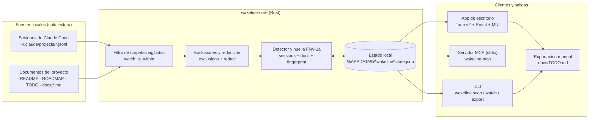
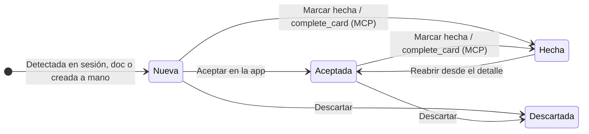

<p align="center">
  
</p>

<h1 align="center">Wakeline</h1>

<p align="center"><b>Una bandeja de pendientes para los proyectos que construyes con agentes de IA.</b></p>

<p align="center"><a href="README.md">English</a> · Español</p>

---

Wakeline es una aplicación de escritorio para Windows y Linux que vigila las carpetas de proyecto que elijas y reúne en tarjetas los errores, tareas e ideas que van quedando en tus sesiones de IA y en los documentos del repositorio.

## Descargar e instalar

Windows x64: extrae el ZIP y abre `wakeline-app.exe` (requiere WebView2 Runtime).
Linux x64: AppImage o DEB, construido en Ubuntu 22.04 para Ubuntu 22.04+ / Debian 12+.
Estos primeros paquetes usan actualización manual y no necesitan certificado comercial.
Consulta las [instrucciones de instalación, MCP y actualización](RELEASE.md).
Los builds de revisión están disponibles como artefactos de CI; los releases se
publican después de su validación.

Cada tarjeta conserva su origen (la sesión, el comando que falló o el archivo donde apareció) y tiene un ciclo simple: puedes aceptarla, marcarla como hecha o descartarla si no te sirve. Wakeline organiza lo que hay que revisar; no modifica tu código por su cuenta y solo analiza las carpetas que tú selecciones.

<p align="center">
  
</p>

## Por qué usar Wakeline

Cuando trabajas con varios proyectos o pasas el día entre sesiones de terminal y agentes, el trabajo pendiente se dispersa muy rápido:

- Un comando falla tres veces seguidas en mitad de una conversación larga, sigues con otra cosa y a la hora ya no recuerdas en qué archivo estaba el fallo.
- El agente termina un cambio y cierra su respuesta con «queda pendiente validar el caso de facturas anuladas». Cierras la ventana y esa nota desaparece en el historial.
- Tienes pendientes repartidos entre `README.md`, notas de hoja de ruta y sesiones de distintos repositorios.

Wakeline lee ese rastro en segundo plano y lo junta en un solo lugar, agrupando lo que se repite para que el mismo fallo no aparezca diez veces.

## Vistas de la aplicación

### Bandeja de tarjetas y detalle con contexto

En **Tarjetas** puedes filtrar por proyecto, tipo (`Error`, `Tarea`, `Idea`) o texto, y alternar entre tabla y tablero Kanban. Al abrir una tarjeta ves el fragmento de código donde ocurre el problema, la salida del comando que falló y las acciones directas para abrir el archivo en VS Code, reanudar la sesión de Claude o copiar el contexto como prompt.

<p align="center">
  
  
</p>

### Ajustes, notificaciones y exclusiones

Desde **Ajustes** controlas las alertas en la bandeja de Windows, el idioma, el tema, la carpeta de exportación (`docs/TODO.md`), la conexión con servidores MCP y las reglas fijas de exclusión de secretos.

<p align="center">
  
</p>

## Casos de uso

### 1. Retomar un error sin buscar en el historial de la terminal

Supongamos que durante una sesión aparece un fallo de tipos en `app/layout.tsx` al correr `npm run typecheck`. En vez de subir cientos de líneas en la consola o buscar en qué sesión ocurrió, abres la tarjeta en Wakeline, ves el mensaje exacto y cuántas veces se repitió, y con un clic abres el archivo en VS Code o reanudas esa sesión de Claude.

### 2. Capturar lo que el agente dejó para después

Es habitual pedirle a un agente que resuelva solo una parte del problema y dejar el resto para más adelante. Cuando en la respuesta final queda escrito lo que falta por hacer o una idea para mejorar el módulo, Wakeline lo detecta y crea una tarjeta de tarea o idea asociada a esa carpeta y rama.

### 3. Cambiar entre varios proyectos sin perder el hilo

Si alternas entre una app web, una app móvil en Expo y una librería en Rust, puedes elegir solo esas tres carpetas en la barra lateral. Wakeline ignora el resto de tu disco, agrupa las tarjetas por proyecto y te avisa en la bandeja de Windows únicamente cuando entra un error nuevo.

### 4. Trabajar las tarjetas desde el chat con MCP

Wakeline incluye un servidor MCP (`wakeline mcp`) por `stdio`. Si lo conectas en Claude Code, Codex o Antigravity, puedes pedirle al agente desde el chat:

> «Mira las tarjetas abiertas de este proyecto y ayúdame con el error de `app/layout.tsx`».

El agente puede consultar las tarjetas (`list_cards`, `get_card`), anotar una nueva (`create_card`) o marcarla como terminada (`complete_card`) cuando acabes. Por diseño no existe herramienta de borrado: un agente nunca puede eliminar tu historial.

## Arquitectura

El proyecto está dividido en un núcleo en Rust sin dependencias de interfaz y tres puntos de entrada que comparten las mismas reglas de lectura, deduplicación y almacenamiento.



### Cómo se identifica y conserva cada tarjeta

Cada hallazgo se normaliza (quitando fechas, horas, rutas temporales y números de línea variables) y se resume en una huella `FNV-1a` (`Fingerprint`). Gracias a esa huella:

- Si un comando falla tres veces con el mismo error en distintos momentos de una sesión, se agrupa en **una sola tarjeta** con contador `×3`.
- Cuando aceptas, completas o descartas una tarjeta, la decisión se guarda asociada a su huella en `%APPDATA%\wakeline\state.json`. En los siguientes escaneos la tarjeta conserva su estado.



### Componentes del espacio de trabajo

| Componente | Responsabilidad |
| --- | --- |
| `crates/wakeline-core` | Lectura incremental de sesiones JSONL de Claude Code, análisis de secciones de pendientes en Markdown, cálculo de huellas `FNV-1a`, lista fija de exclusiones (`.env`, credenciales, llaves), redacción de tokens, enfriamiento de alertas y persistencia en `%APPDATA%\wakeline\state.json`. |
| `crates/wakeline-mcp` | Servidor JSON-RPC 2.0 sobre `stdio` compatible con MCP (`2024-11-05`, `2025-11-25` y `2026-07-28`). Expone `list_cards`, `get_card`, `create_card` y `complete_card` leyendo exactamente las mismas fuentes y carpetas vigiladas que la aplicación de escritorio. |
| `crates/wakeline-cli` | Ejecutable de línea de comandos (`wakeline scan`, `wakeline watch`, `wakeline export`, `wakeline mcp`). |
| `apps/desktop` | Aplicación nativa para Windows construida con Tauri v2 (`src-tauri`) y React 19 + MUI v7 (`src`). Incluye bandeja del sistema, notificaciones nativas de Windows por errores nuevos, selector de carpetas y apertura directa en VS Code. |

## Qué lee hoy (y qué no)

| Fuente | Qué recoge Wakeline |
| --- | --- |
| Sesiones de Claude Code | Errores repetidos de herramientas o comandos y trabajo pendiente mencionado en las sesiones de `~/.claude/projects` cuyo directorio pertenezca a tus carpetas vigiladas |
| Documentos del proyecto | Secciones de pendientes, brechas conocidas y hojas de ruta en archivos Markdown (`README`, `ROADMAP`, `TODO`, `docs/*.md`) dentro de las carpetas elegidas |
| Manual y MCP | Tarjetas que creas desde la aplicación o desde tu agente por MCP |

**Límites claros:**

- **Solo lee las carpetas que eliges.** Hasta que no añades una carpeta, Wakeline no muestra ni analiza nada.
- **No toca secretos.** Tiene una lista fija de exclusiones (`.env`, credenciales, llaves privadas, tokens de sesión) y un filtro que redacta cualquier token antes de guardar una tarjeta.
- **Todo queda en tu máquina.** Las carpetas vigiladas y el estado de tus tarjetas se guardan localmente en `%APPDATA%\wakeline\state.json`, y puedes exportar las tarjetas abiertas a `docs/TODO.md` cuando quieras.

## Desarrollo

Requisitos en Windows 11: Rust (estable), Node.js 20+ y WebView2.

```bash
# Ejecutar las pruebas del núcleo, la CLI y el servidor MCP
cargo test -p wakeline-core -p wakeline-cli -p wakeline-mcp

# Usar la CLI o arrancar el servidor MCP
cargo run -p wakeline-cli -- --help

# Arrancar la aplicación de escritorio en modo desarrollo
cd apps/desktop
npm install
npm run tauri dev
```

## Licencia

Doble licencia [MIT](LICENSE-MIT) o [Apache 2.0](LICENSE-APACHE), a tu elección.

La interfaz de escritorio está basada en [Minimal UI Kit](https://github.com/minimal-ui-kit/material-kit-react) (edición gratuita, MIT). Consulta [THIRD_PARTY_LICENSES.md](THIRD_PARTY_LICENSES.md).
