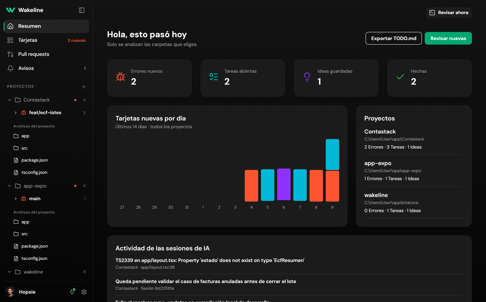
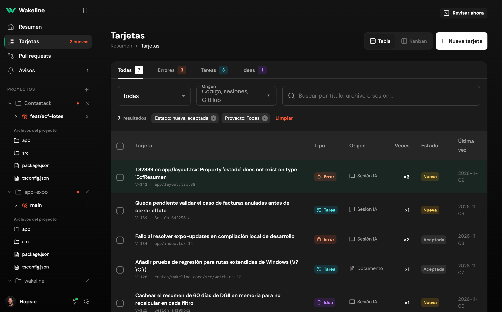
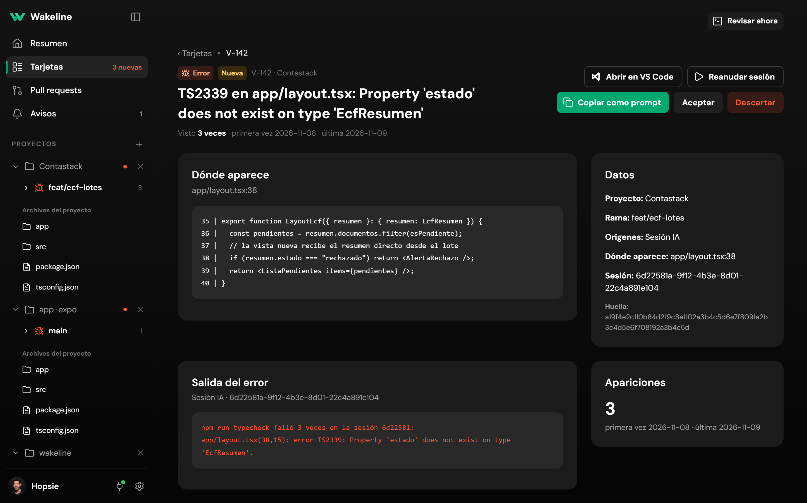
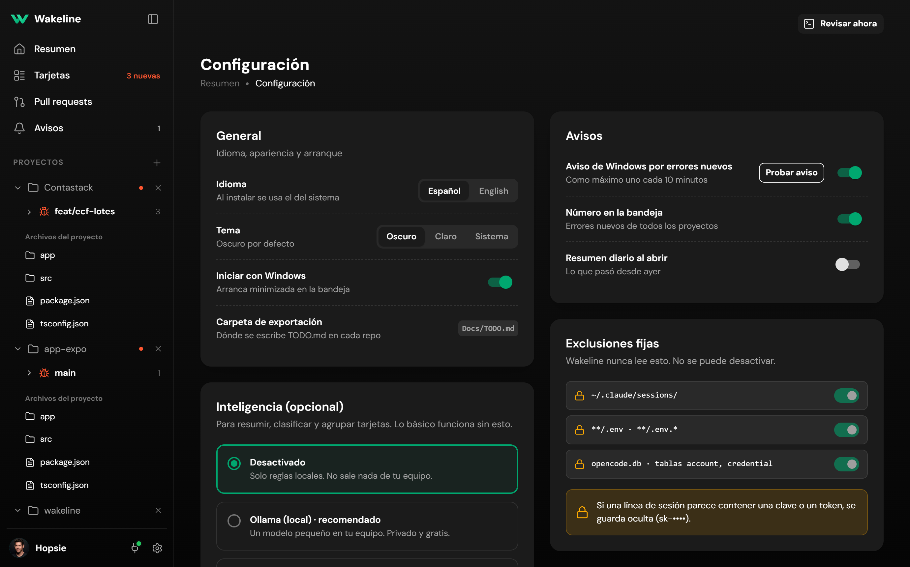
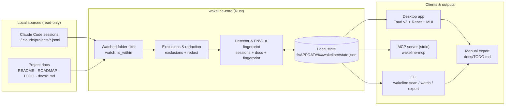
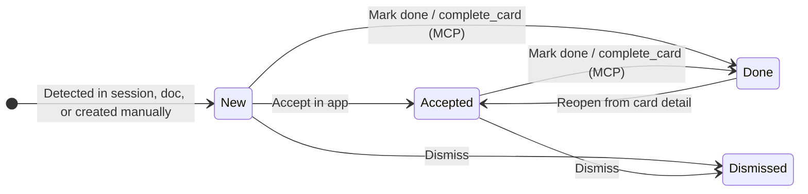

<p align="center">
  
</p>

<h1 align="center">Wakeline</h1>

<p align="center"><b>A pending-work inbox for the projects you build with AI agents.</b></p>

<p align="center">English · <a href="README.es.md">Español</a></p>

---

Wakeline is a desktop app for Windows and Linux that watches the project folders you choose and gathers the errors, tasks, and ideas left behind in your AI coding sessions and repository docs into cards.

## Download and install

Windows x64: extract the ZIP and run `wakeline-app.exe` (WebView2 Runtime required).
Linux x64: AppImage or DEB, built on Ubuntu 22.04 for Ubuntu 22.04+ / Debian 12+.
These initial packages use manual updates and no commercial signing certificate.
See [installation, MCP setup and update instructions](RELEASE.md). Review builds are
available as CI artifacts; public releases appear only after validation.

Each card keeps its origin (the session, the command that failed, or the file where it was found) and follows a simple workflow: accept it, mark it as done, or dismiss it. Wakeline organizes what needs your attention; it does not edit your code on its own, and it only scans the folders you select.

<p align="center">
  
</p>

## Why use Wakeline

When you work across several projects or run multiple AI sessions a day, unfinished work gets buried fast:

- A command fails three times in the middle of a long terminal session, you move on to something else, and an hour later you cannot remember which file broke.
- An agent finishes a feature and notes at the end of its reply that edge-case validation is still pending. Once you close that terminal tab, the note is gone.
- Follow-up tasks end up split between `README.md`, roadmap notes, and chat histories across different repositories.

Wakeline reads those traces in the background and puts them in one inbox, grouping repeated failures into a single card so the same error does not clutter your list ten times.

## App views

### Card inbox and context detail

In **Cards**, you can filter by project, type (`Error`, `Task`, `Idea`), or search query, and switch between the table view and a Kanban board. Opening a card shows the code excerpt where the issue happened, the failing command output, and direct actions to open the file in VS Code, resume the Claude session, or copy the context as a prompt.

<p align="center">
  
  
</p>

### Settings, notifications, and hard exclusions

In **Settings**, you control Windows tray notifications, language, theme, the `docs/TODO.md` export path, MCP server connections, and the built-in secret exclusion rules.

<p align="center">
  
</p>

## Use cases

### 1. Pick up a failing file without digging through terminal history

Say a type check fails in `app/layout.tsx` while running `npm run typecheck` during an AI session. Instead of scrolling through hundreds of lines of terminal output to find which session hit the error, you open the card in Wakeline, review the context and how many times it happened, and jump straight to the file in VS Code or resume that Claude session.

### 2. Catch follow-ups the agent left for later

You often ask an agent to solve one part of a problem and leave the rest for later. When the agent mentions pending work or suggests a follow-up idea in its reply, Wakeline turns it into a task or idea card tied to that project folder and branch.

### 3. Switch between projects without losing track

If you bounce between a web app, an Expo mobile project, and a Rust workspace, you can add just those folders in the sidebar. Wakeline ignores the rest of your disk, groups cards by project, and sends a Windows tray notification only when a new error card appears.

### 4. Work through cards from chat with MCP

Wakeline includes an MCP server (`wakeline mcp`) over `stdio`. Once connected to Claude Code, Codex, or Antigravity, you can ask your agent in chat:

> "Check the open cards for this project and help me fix the error in `app/layout.tsx`."

The agent can query your inbox (`list_cards`, `get_card`), log a new item (`create_card`), or mark a card done (`complete_card`) once you finish. By design, there is no delete tool: an agent can never wipe your card history.

## Architecture

Wakeline separates its Rust core from three entry points (Desktop UI, MCP server, and CLI) that share the exact same scanning, deduplication, and local state logic.



### How cards are fingerprinted and persisted

Every finding is normalized (stripping timestamps, temporary paths, and shifting line numbers) and hashed into a stable `FNV-1a` `Fingerprint`:

- If a command fails three times with the same error during a session, Wakeline collapses those occurrences into **one card** with a `×3` counter.
- When you accept, complete, or dismiss a card, that decision is stored by fingerprint in `%APPDATA%\wakeline\state.json`, so rescanning the project never resets your decisions.



### Workspace components

| Component | Responsibility |
| --- | --- |
| `crates/wakeline-core` | Incremental reader for Claude Code JSONL sessions, Markdown pending-section parser, `FNV-1a` fingerprinting, hard secret exclusions (`.env`, credentials, private keys), token redaction, alert cooldowns, and local state persistence in `%APPDATA%\wakeline\state.json`. |
| `crates/wakeline-mcp` | JSON-RPC 2.0 server over `stdio` supporting MCP protocol versions `2024-11-05`, `2025-11-25`, and `2026-07-28`. Exposes `list_cards`, `get_card`, `create_card`, and `complete_card` over the same watched folders and sources as the desktop app. |
| `crates/wakeline-cli` | Command-line binary (`wakeline scan`, `wakeline watch`, `wakeline export`, `wakeline mcp`). |
| `apps/desktop` | Native Windows desktop app built with Tauri v2 (`src-tauri`) and React 19 + MUI v7 (`src`). Includes system tray integration, native Windows toast notifications for new errors, folder picker, and direct VS Code deep links. |

## What it reads today (and what it doesn't)

| Source | What Wakeline collects |
| --- | --- |
| Claude Code sessions | Repeated tool/command errors and pending work or ideas mentioned in `~/.claude/projects` sessions whose working directory belongs to your watched folders |
| Project docs | Pending items, known gaps, and roadmap sections in Markdown files (`README`, `ROADMAP`, `TODO`, `docs/*.md`) inside your selected folders |
| Manual and MCP | Cards created directly in the desktop app or through the MCP server |

**Clear boundaries:**

- **Only scans folders you select.** Until you pick a folder, Wakeline stays empty.
- **Never touches secrets.** A fixed exclusion list (`.env`, credential stores, private keys, session tokens) and a redaction filter strip sensitive tokens before any card is created.
- **Stays on your machine.** Watched folders and card statuses are saved locally in `%APPDATA%\wakeline\state.json`, and you can export open cards to `docs/TODO.md` anytime.

## Development

Requirements on Windows 11: Rust (stable), Node.js 20+, and WebView2.

```bash
# Run core, CLI, and MCP tests
cargo test -p wakeline-core -p wakeline-cli -p wakeline-mcp

# Run the CLI or start the MCP server
cargo run -p wakeline-cli -- --help

# Start the desktop app in development mode
cd apps/desktop
npm install
npm run tauri dev
```

## License

Licensed under the [MIT License](LICENSE-MIT).

The desktop interface is based on [Minimal UI Kit](https://github.com/minimal-ui-kit/material-kit-react) (free edition, MIT). See [THIRD_PARTY_LICENSES.md](THIRD_PARTY_LICENSES.md).
