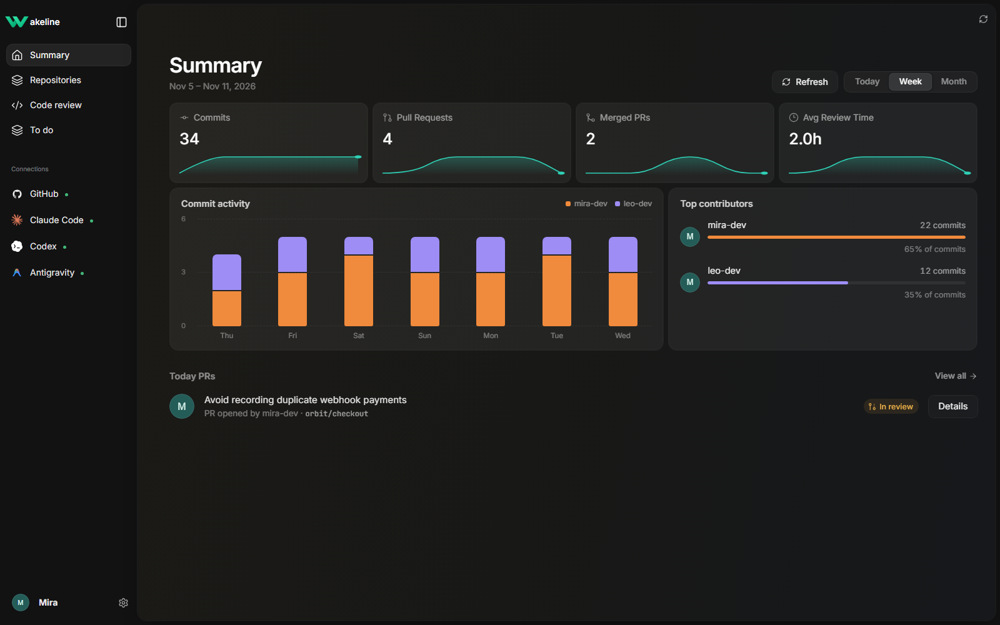
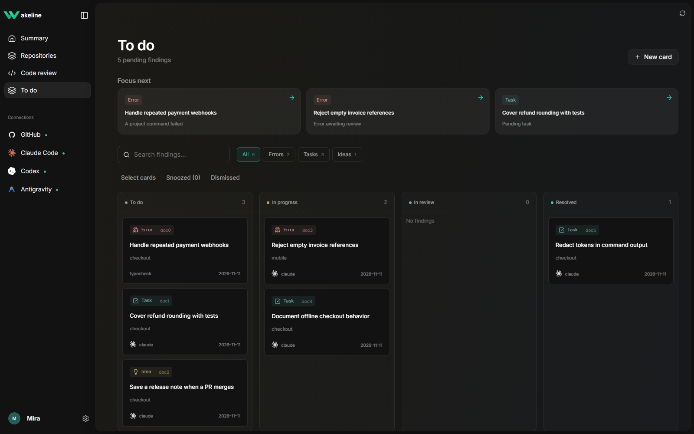
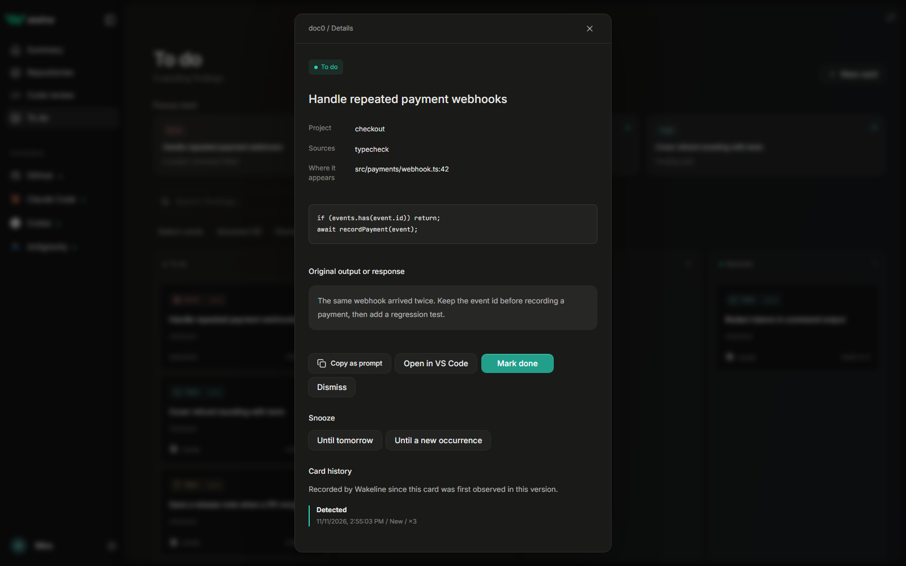
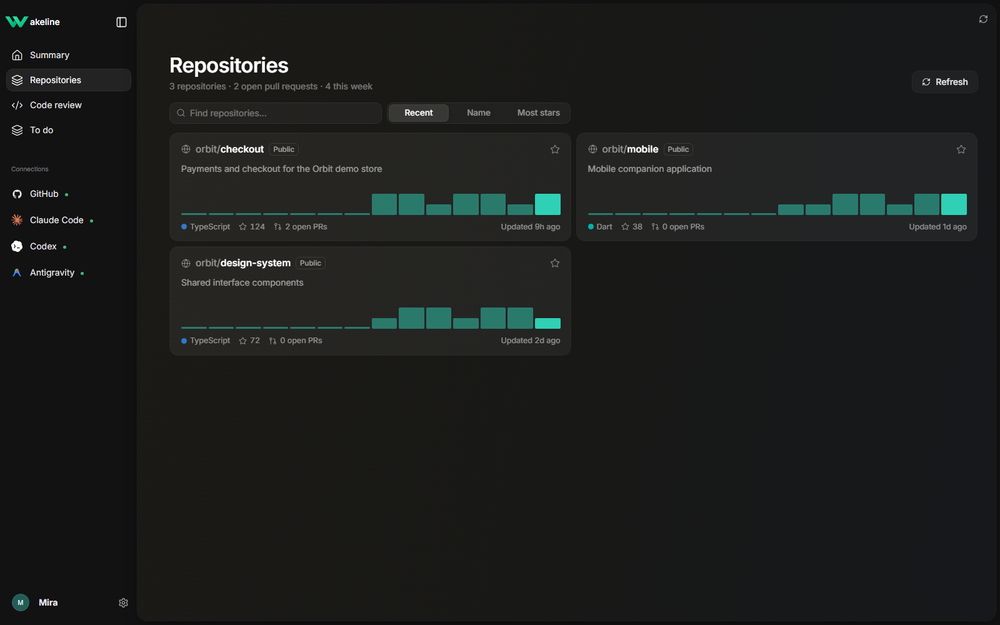
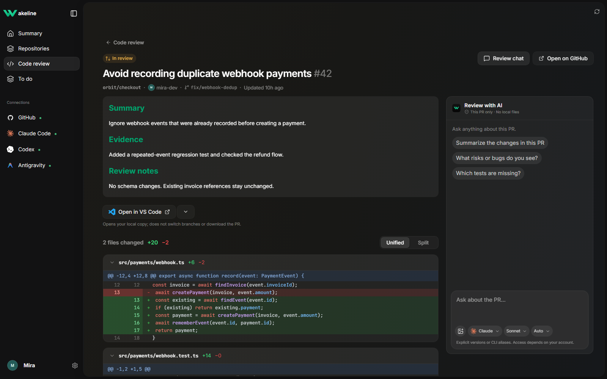
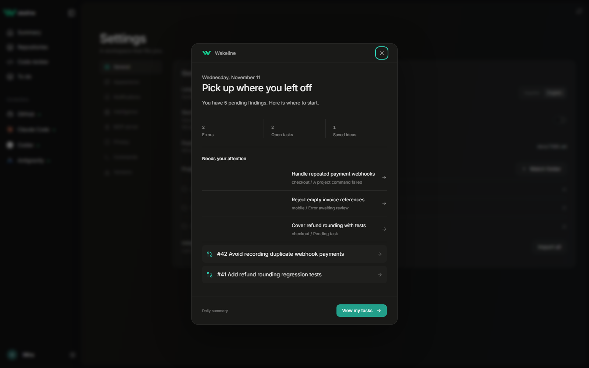
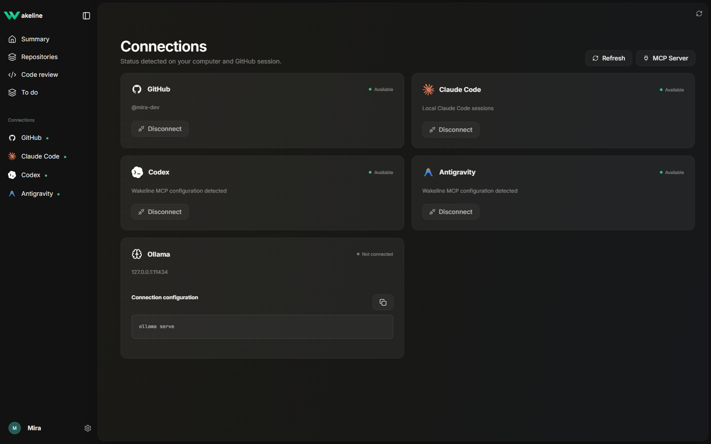
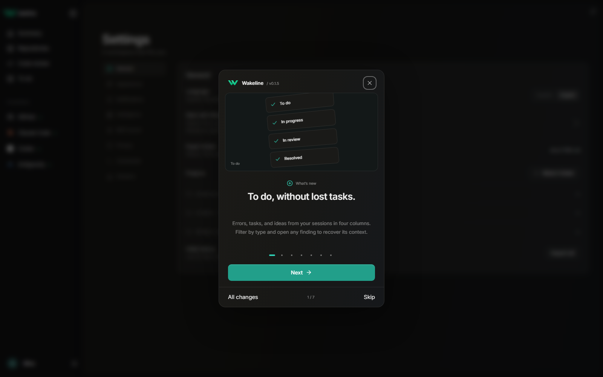

<p align="center"></p>
<h1 align="center">Wakeline</h1>
<p align="center">Keep the errors, tasks, and ideas your AI coding sessions leave behind.</p>
<p align="center">English · <a href="README.es.md">Español</a></p>

Wakeline is a local-first desktop app for Windows and Linux. It turns findings from selected projects, Claude Code sessions, source comments, command results, project documents, and GitHub into an actionable inbox. Your projects and decisions stay on your computer.

[Download the latest release](https://github.com/hopsiedev/wakeline/releases/latest) · [Installation and updates](RELEASE.md) · [What's new in 0.1.7](RELEASE-NOTES.md)



_All screenshots use fictional projects, accounts, code, and activity. They are captured from the real interface; example data is not loaded by the shipped app._

## Install and get started

1. **Windows:** install `Wakeline_*_x64-setup.exe`, or extract the portable ZIP and run `wakeline-app.exe`. WebView2 is required. Keep `wakeline.exe` beside the portable app for MCP.
2. **Linux:** use the AppImage or DEB. AppImage users may need FUSE 2; use `--appimage-extract-and-run` where needed. See [platform instructions](RELEASE.md).
3. Open **Settings → General** using the gear beside your profile. Add the project folders you want Wakeline to watch. No selected folders means no local project scans.
4. Install [GitHub CLI](https://cli.github.com/) and run `gh auth login` to see your repositories, pull requests, and GitHub profile. Wakeline uses that existing session.
5. Open **To do** for findings and **Code review** for pull requests. Settings contains language, appearance, notifications, intelligence, MCP, commands, and version history.

## To do: from a finding to a next step



- Filter with **All, Errors, Tasks, Ideas**, search the text, and narrow down by project.
- Drag cards between **Pending, In progress, In review, Done**, or use the available keyboard actions. In review preserves the accepted backend status while tracking the board stage.
- Open a card to read its origin, evidence, occurrence count, and history. Copy its context as a prompt, open the related file, or resume its Claude session when available.
- Use priorities to see which pending items need attention and why: repeated errors, failing project commands, or aging tasks.
- **Snooze** until tomorrow or another occurrence, then resume the item without losing its history. Snoozed items are kept, not deleted.
- Create a manual finding, select several cards for a bulk action, or export open items to the project's `docs/TODO.md`. Export is explicit, not an automatic rewrite of your documents.



## Repositories and Code review



Browse the repositories your GitHub account can access. Sort by recent activity, name, or stars, mark favorites, and open their pull requests. Synchronization uses a local cache and incremental refreshes; GitHub access and rate limits still apply.

Filter PRs by **Open, In review, Merged, Closed**. Open **Details** for the description, file list, and syntax-highlighted **Unified / Split** diff. Open the PR on GitHub when you need to review or merge it there: Wakeline does not merge PRs for you.



### Ask AI about a PR

1. Install and authenticate **Claude Code** on the same machine.
2. Open **Review chat** from Code review to ask about the listed PRs. That conversation uses cached PR metadata, not the contents of every repository.
3. Open a specific PR to ask about its title, description, and filtered diff. That PR has a separate conversation; it is not mixed with the overview chat.
4. Choose a CLI alias or a specific model version, then an effort level. Choices are remembered. Model and effort access depend on your Claude account and CLI; selecting a model does not grant access to it.
5. Type your question. **Enter** sends; **Shift+Enter** inserts a line. The input grows with the text. Add an image with the image button or paste it with **Ctrl+V**; preview or remove it before sending. Up to 3 PNG/JPEG/WebP/GIF images, 5 MB each and 10 MB total.
6. Use **Review chat** to close or reopen the panel. Its placement is consistent between the review list and PR detail.

Claude runs with tools disabled in a temporary empty directory. The PR context is filtered and redacted before sending. Attachments are explicitly selected by you and sent to the model. Codex and Antigravity can connect through MCP; they are not yet enabled as isolated review-chat providers. Chat conversations and attachments currently remain in memory during the app session, not as a permanent chat archive.

### Open your local copy in an editor

Below the PR summary, choose **VS Code, Cursor, or Antigravity**. Wakeline remembers your choice until you change it. The matching local repository must be in your watched projects and the editor must be installed. Opening it does not clone the repository, check out the PR branch, or run project code.

## Daily summary and notifications



Enable **Settings → Notifications → Summary on open** to see an actionable summary once per local calendar day when there are relevant changes or pending items. It shows errors, tasks, ideas, priorities, completed findings, and PRs needing attention. You can reopen it from Settings. Empty activity does not produce a negative productivity badge.

Errors and new PRs can also produce system notifications on Windows and Linux. Enable the relevant channels and allow the OS to show notifications. Delivery follows system settings, rate limits, deduplication, and whether Wakeline is running. Connection indicators stay green regardless of the accent color.

On Windows, the installed app can start in the background and use the system tray. On Linux, tray behavior depends on your desktop environment; closing the window exits the app.

## Connect your agents with MCP



Open your profile menu → **Connections**, then **MCP Server**. Settings shows copyable commands using the installed CLI path. With `wakeline` in PATH, the equivalents are:

```sh
claude mcp add wakeline -- wakeline mcp
codex mcp add wakeline -- wakeline mcp
```

For Antigravity, merge this entry into its MCP configuration, using an absolute executable path if needed:

```json
{
  "mcpServers": {
    "wakeline": {
      "command": "wakeline",
      "args": ["mcp"]
    }
  }
}
```

Ask your agent, from its chat or CLI: “Add ‘fix the login bug’ to my Wakeline To Do” or “Move W-003 to in progress”. Tools: `list_cards`, `get_card`, `create_card`, `move_card` and `complete_card`; there is no delete tool. The MCP server only touches To Do: it never reads project folders, and it can add cards for projects you do not watch. Refresh Connections after configuring a client. Disconnect displays the appropriate client command for you to run; it does not silently rewrite another application's configuration.

MCP access to cards and the in-app isolated PR chat are separate capabilities.

## Commands, intelligence, and privacy

- Define allowed project commands in `wakeline.toml`, review their executable/arguments, and explicitly approve them before running them in Wakeline. A changed command definition requires approval again. See `cargo run -p wakeline-cli -- --help` for `trust` and `run`.
- Optional local Ollama or external-provider settings are in **Settings → Intelligence**. Saving a provider configuration does not run a model or make every provider a PR-chat backend. API keys use the supported OS secure store; unsupported secure storage is reported.
- Watched folders, card decisions, and session offsets are persisted locally. Fixed credential/private-file exclusions and text redaction remain active. The app does not scan arbitrary folders or automatically edit your source code.
- Keep backups of the app's state and WebView preferences. A normal upgrade retains the app identifier, state location, projects, card fingerprints, and preferences; do not delete the old profile when updating.

## Update and revisit the announcement

Open the profile menu → **Check for updates**, or **Settings → Versions**. The control shows checking, up to date, a new version, or an error based on the real result. Windows installed builds use the signed updater; portable ZIP and Linux packages follow the [manual update instructions](RELEASE.md).

**Settings → Versions → View changes** reopens the illustrated announcement at any time.



## CLI and development

```sh
wakeline scan /path/to/project
wakeline watch
wakeline export /path/to/project
wakeline mcp
```

Development needs Rust stable, Node.js 22+, and Tauri's platform dependencies (WebView2 on Windows; WebKitGTK and packaging libraries on Linux).

```sh
cargo test --workspace
cargo fmt --all -- --check
cargo clippy --workspace --all-targets -- -D warnings
cd apps/desktop
npm ci
npm run lint
npm run fm:check
node --test tests/*.test.mjs
npm run build
npm run tauri dev
```

To regenerate documentation images: run `npm run dev`, then `npx playwright install chromium` and `npm run docs:screenshots` in another terminal. The capture script intercepts the development API with synthetic fixtures and checks chat alignment, resizing, and open/close controls. It never reads real sessions or invokes agents. Set `WAKELINE_DOCS_URL` to use another local dev-server URL. Fixtures and the debug review bridge are not production data sources.

The Rust core is shared by the desktop app, CLI, and MCP server. See [THIRD_PARTY_LICENSES.md](THIRD_PARTY_LICENSES.md) for interface, library, font, and logo credits. Licensed under [MIT](LICENSE-MIT).
From 0.1.6, a new version triggers a system notification and a green sidebar indicator. Open it and choose **Update now**. The app waits for your action before installing; portable and Linux builds open the manual download. Weekly/monthly metrics show comparisons when a prior baseline exists; Today has no percentage.
