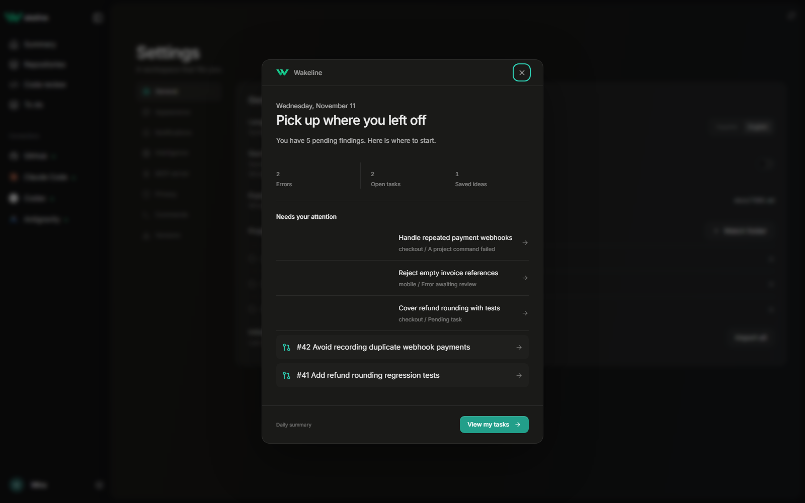
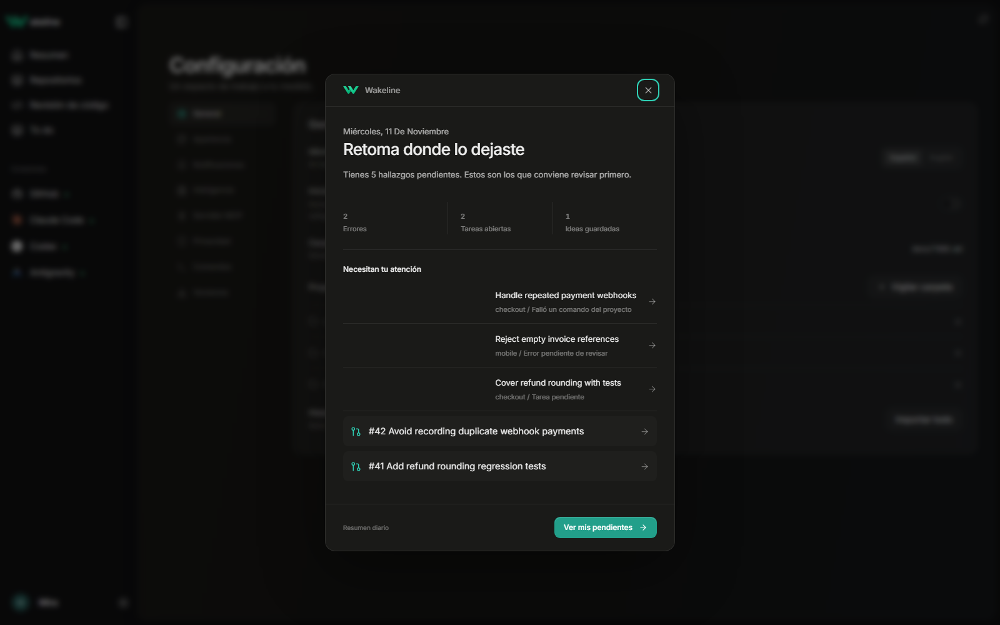

# Wakeline 0.1.7 — Stability and GitHub fixes

This release also includes every 0.1.6 change (daily summary, dismissible menus and update notifications), which was not published separately.

- Settings no longer freezes while the session history imports: every command that reads local state runs off the window thread, and the import keeps its progress when you leave Settings and come back.
- **Refresh** in Code review asks GitHub again instead of reusing the 10-minute cache, and the app rereads GitHub every 2 minutes, so a new pull request shows up without restarting.
- Commits co-authored by Claude or Codex are credited to their GitHub accounts (`claude`, `codex`) with their profile pictures.
- The review chat session picker uses the app's own menu style. Only sessions where you wrote something are kept.
- Release notes animate and highlight the fixes.
- Code review filters are compact again with the search beside them; commit activity bars no longer overlap.
- To do can add and remove watched folders directly.
- Existing projects, cards, sessions and preferences keep their storage. No migration or reset is required.

Installed Windows builds can use the signed updater. Portable ZIP and Linux packages open the release download for manual installation.

# Wakeline 0.1.7 — Correcciones de estabilidad y GitHub

Esta versión incluye también todos los cambios de la 0.1.6 (resumen diario, menús que se cierran y avisos de actualización), que no se publicó por separado.

- Configuración ya no se congela mientras se importa el historial de sesiones: los comandos que leen el estado local corren fuera del hilo de la ventana y la importación conserva su progreso si sales y vuelves.
- **Actualizar** en Code review vuelve a preguntar a GitHub en lugar de usar la caché de 10 minutos, y la app relee GitHub cada 2 minutos: una PR nueva aparece sin reiniciar.
- Los commits con co-autoría de Claude o Codex se acreditan a sus cuentas de GitHub (`claude`, `codex`) con su foto de perfil.
- El selector de sesiones del chat de revisión usa el menú propio de la app. Solo se guardan las sesiones donde escribiste algo.
- Las notas de la versión animan y destacan las correcciones.
- Los filtros de Code review vuelven a ser compactos con el buscador al lado; las barras de actividad ya no se montan.
- To do permite añadir y quitar carpetas vigiladas.
- Se conservan proyectos, tarjetas, sesiones y preferencias, sin migración ni reinicio de datos.

Windows instalado usa el actualizador firmado. ZIP portable y Linux abren la descarga para actualizar manualmente.
